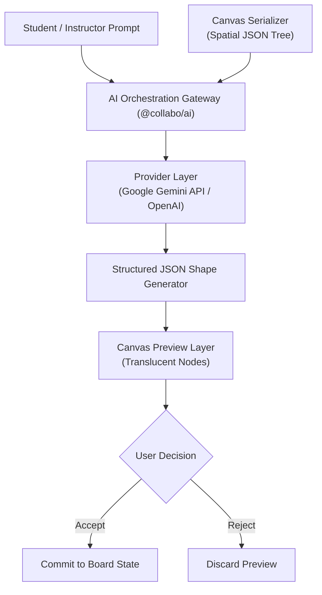

# AI Architecture Specification — COLLABO Intelligence

> **Document Status:** Approved (Milestone M1 Specification)  
> **Package:** `@collabo/ai` (`packages/ai`)  
> **Target Audience:** AI Engineers, Backend Developers, Security & Compliance Officers

---

## 1. Pedagogical AI Philosophy

COLLABO Intelligence is designed as an **active pedagogical collaborator**, not a passive chat interface. 

It adheres to three core design rules:
1. **Spatial Awareness:** The AI understands 2D coordinates, bounding boxes, and visual grouping on the canvas.
2. **Human-in-the-Loop Verification:** AI-generated canvas additions must be rendered on a translucent **Preview Layer** requiring explicit student or instructor approval before committing.
3. **Provider Agnosticism:** Built with an abstraction layer supporting multiple model providers (Google Gemini API, OpenAI, Anthropic, or local open-weights) with zero vendor lock-in.



---

## 2. Core Capabilities & Workflows

### A. Mind-Map & Diagram Generation
* **Input:** Natural language lecture topic, syllabus excerpt, or textbook notes.
* **Process:**
  1. The AI generates a hierarchical tree of concepts with parent-child relationships.
  2. The layout algorithm calculates $(x, y)$ coordinates to prevent shape overlap.
  3. Nodes are styled with alternating pastel fills and connective bezier arrows.
* **Output:** Array of `CanvasElement` objects ready for rendering.

### B. Board-Aware Spatial Q&A
* **Input:** Student question: *"What is the difference between the process table in the yellow box and the thread table in the blue box?"*
* **Process:**
  1. The canvas serializer extracts all nodes on the board, including their text, color, shape type, and spatial coordinates.
  2. The AI matches "yellow box" and "blue box" to specific node bounding boxes.
  3. Generates a grounded explanation referencing the specific components.

### C. Lecture Recaps & Study Material Synthesis
* **Input:** Full session transcript (audio STT) + whiteboard text snapshot + chat logs.
* **Output:**
  1. **Markdown Executive Summary:** 3 paragraphs summarizing the core topic.
  2. **Key Formulas & Diagrams:** Extracted visual equations.
  3. **Practice Quiz:** 5 multiple-choice questions with answer explanations.
  4. **Flashcards:** Anki-compatible Q&A cards for spaced repetition.

---

## 3. Provider-Agnostic Interface Design

```ts
export interface MindMapRequest {
  topic: string;
  depth?: number;
  originX: number;
  originY: number;
}

export interface BoardQARequest {
  query: string;
  elements: CanvasElement[];
}

export interface AIProvider {
  name: string;
  generateMindMap(req: MindMapRequest): Promise<CanvasElement[]>;
  answerBoardQuery(req: BoardQARequest): Promise<string>;
  summarizeLecture(transcript: string, boardElements: CanvasElement[]): Promise<LectureSummary>;
  generateQuiz(concepts: string[]): Promise<QuizQuestion[]>;
}
```

### Primary Candidate: Google Gemini API (via `@google/genai` SDK)
* **Rationale:** Excellent multimodal performance (analyzing images and spatial diagrams alongside text), structured JSON output support, high token context windows, and low latency with `gemini-2.5-flash`.

---

## 4. Structured Output Validation

To prevent malformed JSON from crashing the React Konva canvas, all AI outputs are strictly validated using **Zod schemas**:

```ts
import { z } from "zod";

export const AIShapeSchema = z.object({
  id: z.string(),
  type: z.enum(["rectangle", "circle", "sticky", "text"]),
  x: z.number(),
  y: z.number(),
  width: z.number().optional(),
  height: z.number().optional(),
  text: z.string().optional(),
  color: z.string(),
  strokeWidth: z.number(),
});

export const AIMindMapResponseSchema = z.array(AIShapeSchema);
```

---

## 5. Educational Data Privacy & Compliance

* **No Foundation Model Training:** Student voice transcripts, whiteboard drawings, and questions are processed with zero-retention / non-training API contracts.
* **Tenant Data Isolation:** AI requests include an institutional identifier; no cross-institutional context leakage is permitted.

