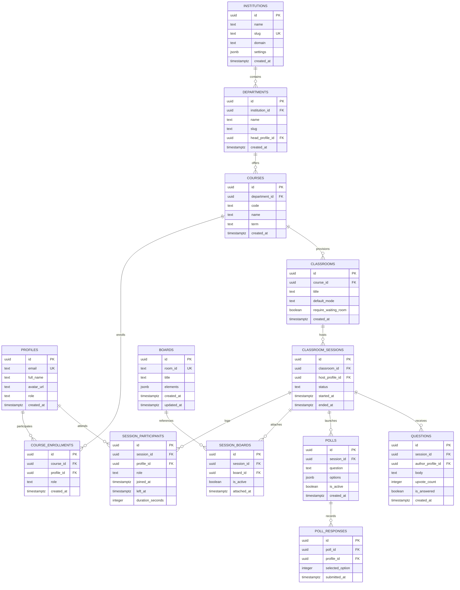

# Database Schema Specification — COLLABO

> **Document Status:** Approved (Milestone M1 Specification)  
> **Database Engine:** PostgreSQL 15+ (Managed via Supabase)  
> **Target Audience:** Backend Engineers, Database Administrators, Security Auditors

---

## 1. Entity-Relationship Overview



---

## 2. Table Specifications & Column Definitions

### 1. `boards` (Preserved Baseline Table)
Stores whiteboard metadata and serialized JSON element snapshots.
```sql
CREATE TABLE IF NOT EXISTS boards (
    id UUID PRIMARY KEY DEFAULT gen_random_uuid(),
    room_id TEXT NOT NULL UNIQUE,
    title TEXT NOT NULL DEFAULT 'Untitled Board',
    elements JSONB NOT NULL DEFAULT '[]'::jsonb,
    created_at TIMESTAMPTZ NOT NULL DEFAULT timezone('utc'::text, now()),
    updated_at TIMESTAMPTZ NOT NULL DEFAULT timezone('utc'::text, now())
);
CREATE INDEX IF NOT EXISTS idx_boards_room_id ON boards(room_id);
```

### 2. `profiles`
Represents user identities linked to Supabase Auth (`auth.users`).
```sql
CREATE TABLE IF NOT EXISTS profiles (
    id UUID PRIMARY KEY REFERENCES auth.users(id) ON DELETE CASCADE,
    email TEXT UNIQUE NOT NULL,
    full_name TEXT NOT NULL,
    avatar_url TEXT,
    system_role TEXT NOT NULL DEFAULT 'student' CHECK (system_role IN ('admin', 'instructor', 'student', 'guest')),
    created_at TIMESTAMPTZ NOT NULL DEFAULT timezone('utc'::text, now())
);
```

### 3. `institutions`
Top-level multi-tenant container for universities, colleges, or schools.
```sql
CREATE TABLE IF NOT EXISTS institutions (
    id UUID PRIMARY KEY DEFAULT gen_random_uuid(),
    name TEXT NOT NULL,
    slug TEXT NOT NULL UNIQUE,
    domain TEXT,
    settings JSONB NOT NULL DEFAULT '{}'::jsonb,
    created_at TIMESTAMPTZ NOT NULL DEFAULT timezone('utc'::text, now())
);
```

### 4. `departments`
Academic faculties within an institution.
```sql
CREATE TABLE IF NOT EXISTS departments (
    id UUID PRIMARY KEY DEFAULT gen_random_uuid(),
    institution_id UUID NOT NULL REFERENCES institutions(id) ON DELETE CASCADE,
    name TEXT NOT NULL,
    slug TEXT NOT NULL,
    head_profile_id UUID REFERENCES profiles(id) ON DELETE SET NULL,
    created_at TIMESTAMPTZ NOT NULL DEFAULT timezone('utc'::text, now()),
    UNIQUE(institution_id, slug)
);
```

### 5. `courses`
Specific academic subjects offered by a department.
```sql
CREATE TABLE IF NOT EXISTS courses (
    id UUID PRIMARY KEY DEFAULT gen_random_uuid(),
    department_id UUID NOT NULL REFERENCES departments(id) ON DELETE CASCADE,
    code TEXT NOT NULL,
    name TEXT NOT NULL,
    term TEXT NOT NULL,
    created_at TIMESTAMPTZ NOT NULL DEFAULT timezone('utc'::text, now()),
    UNIQUE(department_id, code, term)
);
```

### 6. `course_enrollments`
Associates teachers and students with courses.
```sql
CREATE TABLE IF NOT EXISTS course_enrollments (
    id UUID PRIMARY KEY DEFAULT gen_random_uuid(),
    course_id UUID NOT NULL REFERENCES courses(id) ON DELETE CASCADE,
    profile_id UUID NOT NULL REFERENCES profiles(id) ON DELETE CASCADE,
    role TEXT NOT NULL CHECK (role IN ('instructor', 'ta', 'student')),
    created_at TIMESTAMPTZ NOT NULL DEFAULT timezone('utc'::text, now()),
    UNIQUE(course_id, profile_id)
);
```

### 7. `classrooms`
Virtual room definitions linked to a course.
```sql
CREATE TABLE IF NOT EXISTS classrooms (
    id UUID PRIMARY KEY DEFAULT gen_random_uuid(),
    course_id UUID NOT NULL REFERENCES courses(id) ON DELETE CASCADE,
    title TEXT NOT NULL,
    default_mode TEXT NOT NULL DEFAULT 'lecture' CHECK (default_mode IN ('lecture', 'interactive')),
    require_waiting_room BOOLEAN NOT NULL DEFAULT false,
    created_at TIMESTAMPTZ NOT NULL DEFAULT timezone('utc'::text, now())
);
```

### 8. `classroom_sessions`
A live or historical lecture meeting instance.
```sql
CREATE TABLE IF NOT EXISTS classroom_sessions (
    id UUID PRIMARY KEY DEFAULT gen_random_uuid(),
    classroom_id UUID NOT NULL REFERENCES classrooms(id) ON DELETE CASCADE,
    host_profile_id UUID NOT NULL REFERENCES profiles(id),
    status TEXT NOT NULL DEFAULT 'scheduled' CHECK (status IN ('scheduled', 'live', 'ended')),
    started_at TIMESTAMPTZ,
    ended_at TIMESTAMPTZ,
    created_at TIMESTAMPTZ NOT NULL DEFAULT timezone('utc'::text, now())
);
```

### 9. `session_participants`
Automated attendance and participation log.
```sql
CREATE TABLE IF NOT EXISTS session_participants (
    id UUID PRIMARY KEY DEFAULT gen_random_uuid(),
    session_id UUID NOT NULL REFERENCES classroom_sessions(id) ON DELETE CASCADE,
    profile_id UUID NOT NULL REFERENCES profiles(id) ON DELETE CASCADE,
    role TEXT NOT NULL DEFAULT 'attendee' CHECK (role IN ('host', 'co-host', 'speaker', 'attendee')),
    joined_at TIMESTAMPTZ NOT NULL DEFAULT timezone('utc'::text, now()),
    left_at TIMESTAMPTZ,
    duration_seconds INTEGER DEFAULT 0
);
CREATE INDEX IF NOT EXISTS idx_session_participants ON session_participants(session_id, profile_id);
```

### 10. `session_boards`
Junction table linking a classroom session to one or more persistent whiteboards.
```sql
CREATE TABLE IF NOT EXISTS session_boards (
    id UUID PRIMARY KEY DEFAULT gen_random_uuid(),
    session_id UUID NOT NULL REFERENCES classroom_sessions(id) ON DELETE CASCADE,
    board_id UUID NOT NULL REFERENCES boards(id) ON DELETE CASCADE,
    is_active BOOLEAN NOT NULL DEFAULT true,
    attached_at TIMESTAMPTZ NOT NULL DEFAULT timezone('utc'::text, now()),
    UNIQUE(session_id, board_id)
);
```

---

## 3. Row-Level Security (RLS) Strategy

PostgreSQL Row-Level Security is strictly enforced:

1. **Course Isolation:** A student enrolled in Course A cannot view attendance logs, sessions, or private boards of Course B.
2. **Attendance Privacy:** Students can only read their own `session_participants` rows; instructors can read all attendee rows for courses they instruct.
3. **Open Boards Backward Compatibility:** Boards with no associated `session_boards` link remain accessible via public link sharing.
