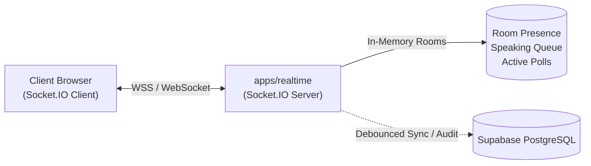
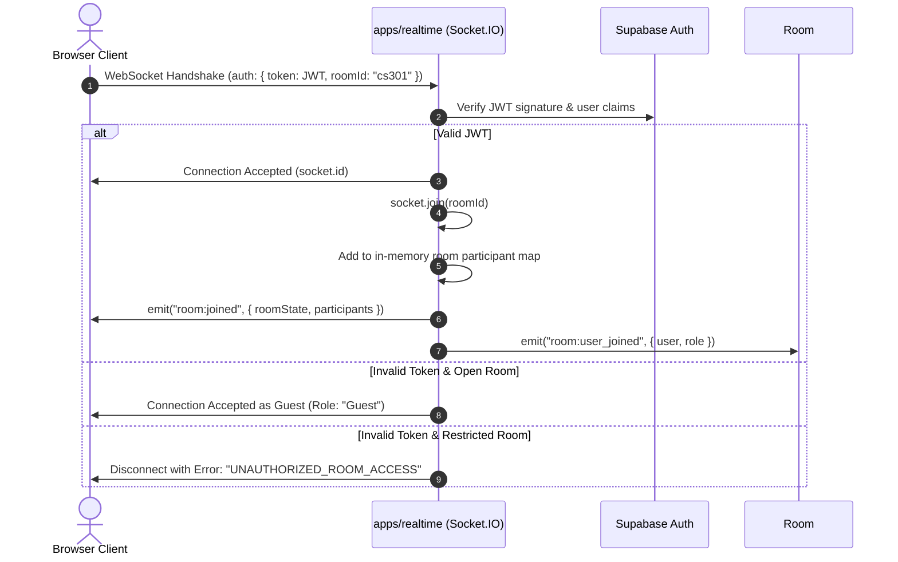

# Real-Time Control Plane Architecture — COLLABO

> **Document Status:** Approved (Milestone M1 Specification)  
> **Server Runtime:** Node.js + TypeScript (`apps/realtime`)  
> **Protocol:** WebSockets / Socket.IO 4.8+  
> **Target Audience:** Real-time Engineers, Full-Stack Developers, DevOps

---

## 1. Role of the Control Plane

The Control Plane is responsible for **room state, participant presence, permissions, speaking queues, and ephemeral events**.

It is strictly decoupled from:
- The **Media Plane** (LiveKit SFU handling high-bandwidth audio and screen share packets).
- The **Data Plane** (Supabase PostgreSQL handling durable relational storage).



---

## 2. Connection Lifecycle & Authentication



---

## 3. Event Catalog & Payload Schemas

### A. Room Presence & Lifecycle

#### `room:join`
* **Direction:** Client $\rightarrow$ Server
* **Payload:**
  ```ts
  interface JoinRoomPayload {
    roomId: string;
    token?: string; // Supabase JWT
    guestName?: string;
  }
  ```

#### `room:user_joined`
* **Direction:** Server $\rightarrow$ Room (Broadcast)
* **Payload:**
  ```ts
  interface UserJoinedPayload {
    socketId: string;
    profileId: string;
    name: string;
    avatarUrl?: string;
    role: "host" | "co-host" | "speaker" | "attendee" | "guest";
    joinedAt: string;
  }
  ```

#### `room:user_left`
* **Direction:** Server $\rightarrow$ Room (Broadcast)
* **Payload:**
  ```ts
  interface UserLeftPayload {
    socketId: string;
    profileId: string;
  }
  ```

---

### B. Classroom & Speaking Queue Controls

#### `classroom:raise_hand`
* **Direction:** Client $\rightarrow$ Server
* **Payload:** `{ roomId: string }`
* **Server Action:** Appends user to `speakingQueue` array in memory.
* **Broadcast:** `classroom:queue_updated` with ordered queue list.

#### `classroom:grant_mic`
* **Direction:** Host Client $\rightarrow$ Server
* **Payload:** `{ roomId: string, targetSocketId: string }`
* **Server Action:**
  1. Validates caller is `host` or `co-host`.
  2. Generates a signed LiveKit publisher token grant.
  3. Emits `classroom:mic_granted` to the specific target socket.

#### `classroom:revoke_mic`
* **Direction:** Host Client $\rightarrow$ Server
* **Payload:** `{ roomId: string, targetSocketId: string }`
* **Server Action:** Cuts speaking rights and forces client mute.

#### `classroom:mute_all`
* **Direction:** Host Client $\rightarrow$ Server
* **Payload:** `{ roomId: string }`
* **Server Action:** Emits master mute to all non-host participants.

---

### C. Whiteboard Ephemeral Signaling

#### `cursor:move`
* **Direction:** Client $\rightarrow$ Server
* **Throttle:** Throttled to 30–50ms on the client.
* **Payload:**
  ```ts
  interface CursorMovePayload {
    roomId: string;
    x: number;
    y: number;
  }
  ```
* **Broadcast:** `cursor:update` broadcast using `socket.to(roomId).volatile.emit(...)`.
  *(Note: volatile emit drops packets if network buffer is congested, preventing packet backlog).*

---

### D. Classroom Chat & Live Polls

#### `chat:message`
* **Direction:** Bi-directional
* **Payload:**
  ```ts
  interface ChatMessage {
    id: string;
    roomId: string;
    senderId: string;
    senderName: string;
    senderRole: string;
    body: string;
    timestamp: string;
  }
  ```

#### `poll:launch` & `poll:vote`
* **Direction:** Host $\rightarrow$ Server $\rightarrow$ Room
* **Payload:**
  ```ts
  interface PollPayload {
    pollId: string;
    question: string;
    options: string[];
    durationSeconds: number;
  }
  ```

---

## 4. Heartbeat, Disconnection & Reconnection

* **Ping / Pong Interval:** Default 25 seconds ping, 20 seconds timeout.
* **Ephemeral Disconnect Buffer:** When a client drops, the server marks them "disconnected (grace period 30s)". If the client reconnects within 30 seconds with their session token, their speaking queue position and role are restored seamlessly.

---

## 5. Horizontal Scaling Strategy (Redis Adapter)

While a single Node.js Socket.IO instance easily handles 10,000+ concurrent connections, multi-instance horizontal scaling will use `@socket.io/redis-adapter` when required:

```
[Load Balancer / Cloudflare]
       ├── Instance A (apps/realtime) ───┐
       ├── Instance B (apps/realtime) ───┼──> [Redis Pub/Sub Cluster]
       └── Instance C (apps/realtime) ───┘
```
