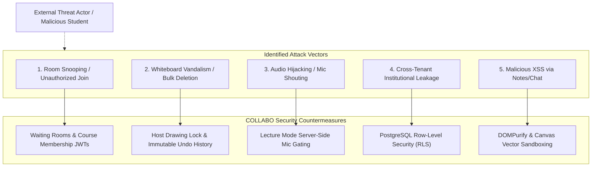

# Security & Compliance Specification — COLLABO

> **Document Status:** Approved (Milestone M1 Specification)  
> **Target Audience:** Security Engineers, Compliance Officers, Platform Architects

---

## 1. Threat Model & Risk Surface



---

## 2. Authentication & Identity Architecture

COLLABO uses **Supabase Auth** for identity management:
* **Authentication Providers:**
  - Passwordless Magic Links via institutional email (`user@university.edu`).
  - Social OAuth (Google, GitHub) for independent hackathon participants.
  - Future: SAML 2.0 / Single Sign-On (SSO) for enterprise campus identity providers.
* **Token Verification Flow:**
  - Every authenticated web request transmits a cryptographically signed JWT.
  - `apps/realtime` verifies the JWT signature during the WebSocket handshake before joining a protected course room.
  - Expired tokens trigger automated token refresh; invalid tokens reject the socket connection.

---

## 3. Role-Based Access Control (RBAC)

We maintain strict separation between **Platform Roles** and **Session Roles**:

```
[System Identity]
  ├── System Role (Admin | Faculty | Student | Guest)
  │     └── Dictates which courses, departments, and billing settings can be accessed.
  │
  └── Session Role (Host | Co-Host | Speaker | Attendee)
        └── Dictates real-time permissions during an active lecture session.
```

### Session Permission Rules:
* In **Lecture Mode**, attendees have **no microphone publish permissions** in LiveKit.
* A student cannot publish audio simply by toggling their local microphone; the LiveKit token issued to them strictly forbids audio publishing until the host executes `classroom:grant_mic`.
* Once granted, `apps/realtime` issues an updated short-lived LiveKit token granting publish permissions for that track only.

---

## 4. PostgreSQL Row-Level Security (RLS) Policies

All database access adheres to principle of least privilege:

### Example Policy: Student Attendance Privacy
```sql
ALTER TABLE session_participants ENABLE ROW LEVEL SECURITY;

-- Students can only inspect their own attendance history
CREATE POLICY "Students view own attendance"
    ON session_participants FOR SELECT
    USING (
        auth.uid() = profile_id
        OR
        EXISTS (
            SELECT 1 FROM course_enrollments ce
            JOIN classrooms c ON c.course_id = ce.course_id
            JOIN classroom_sessions cs ON cs.classroom_id = c.id
            WHERE cs.id = session_participants.session_id
            AND ce.profile_id = auth.uid()
            AND ce.role IN ('instructor', 'ta')
        )
    );
```

### Example Policy: Course Department Isolation
```sql
ALTER TABLE courses ENABLE ROW LEVEL SECURITY;

-- Enrolled students and faculty can access course materials
CREATE POLICY "Members can view enrolled courses"
    ON courses FOR SELECT
    USING (
        EXISTS (
            SELECT 1 FROM course_enrollments
            WHERE course_enrollments.course_id = courses.id
            AND course_enrollments.profile_id = auth.uid()
        )
    );
```

---

## 5. Media Plane Security (WebRTC)

* **End-to-End Encryption:** Audio packets and screen share tracks are encrypted in transit using **DTLS-SRTP** (Datagram Transport Layer Security / Secure Real-time Transport Protocol).
* **Token Ephemerality:** LiveKit join tokens expire after 10 minutes if unused and are bounded to a specific `room_id` and participant identity.
* **Screen Share Permissions:** Only participants explicitly granted presenter rights receive a token enabling video track publication.

---

## 6. Input Sanitization & Content Defense

1. **HTML5 Canvas Sandboxing:** React Konva draws vector shapes and text to a 2D bitmap buffer on an HTML5 `<canvas>`. This naturally isolates canvas drawing from the DOM, eliminating classical DOM-based XSS inside the whiteboard itself.
2. **Chat & Text Inputs:** All user-supplied text rendered outside the canvas (e.g. chat messages, board titles in headers, tooltips) is sanitized and rendered as escaped React strings (`{message.body}`) without `dangerouslySetInnerHTML`.
3. **Image & File Uploads:** Uploaded images are strictly validated by MIME type (JPEG, PNG, SVG) and max file size (10 MB). SVGs are sanitized using `DOMPurify` to eliminate embedded `<script>` or event attributes before mounting onto the canvas.
