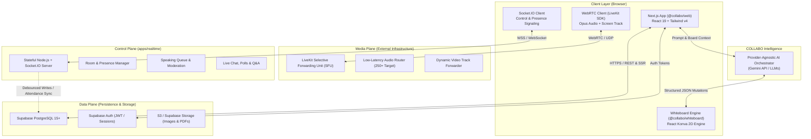

# System Architecture Specification — COLLABO

> **Document Status:** Approved (Milestone M1 Specification)  
> **Target Audience:** System Architects, Lead Engineers, and DevOps Engineers

---

## 1. High-Level Architectural Planes

COLLABO is architected as a distributed system structured across **three operational planes**: the **Control Plane**, the **Media Plane**, and the **Data Plane**.



---

## 2. Component Responsibilities

### A. Frontend Application (`apps/web`)
* **Role:** Web presentation, institutional dashboard, course navigation, and workspace coordination.
* **Technology:** Next.js 16 (App Router), React 19, TypeScript, Tailwind CSS v4.
* **Responsibilities:**
  - Server-Side Rendering (SSR) for SEO-friendly course landing pages and dashboards.
  - Client-side coordination between whiteboard, audio controls, and chat widgets.
  - Zero-latency optimistic UI updates with SWR hydration.

### B. Whiteboard Engine (`packages/whiteboard`)
* **Role:** Declarative 2D canvas rendering and spatial manipulation.
* **Technology:** React Konva (`konva 10.9`, `react-konva 19.3`).
* **Responsibilities:**
  - 60 FPS rendering of vector shapes, paths, sticky notes, and text.
  - Normalized 2D coordinate transformation with pan/zoom camera.
  - Command-pattern local undo/redo stacks.
  - Preview mutation rendering for AI-generated diagrams.

### C. Real-Time Control Plane (`apps/realtime`)
* **Role:** Stateful low-latency message broker and classroom coordinator.
* **Technology:** Standalone Node.js, TypeScript, Socket.IO 4.8+.
* **Responsibilities:**
  - In-memory participant presence tracking per room.
  - Speaking queue state (hand-raise order, microphone grant tokens).
  - Lecture Mode vs. Interactive Mode permission enforcement.
  - Ephemeral whiteboard cursor broadcasting (throttled to 30–50ms).
  - Classroom chat, live polls, and upvoted Q&A.

### D. Media Plane (LiveKit WebRTC SFU)
* **Role:** High-concurrency audio routing and screen sharing.
* **Technology:** LiveKit SFU (Go), WebRTC protocols (RTP/RTCP/SRTP/ICE).
* **Responsibilities:**
  - Ingestion of one Opus voice stream from active speakers.
  - Selective packet replication out to 250+ listening students ($O(N)$ subscriber load).
  - Screen share ingestion and dynamic simulcast forwarding.
  - Audio level metering for speaking activity visualization.

### E. Data Plane (Supabase / PostgreSQL)
* **Role:** Durable long-term relational records and document persistence.
* **Technology:** Managed PostgreSQL 15+, Row-Level Security (RLS).
* **Responsibilities:**
  - Institutional hierarchy: institutions, departments, courses, enrollments.
  - Session metadata, attendance logs, and scheduled lectures.
  - Serialized whiteboard document snapshots (`elements JSONB`).
  - User identity, profile metadata, and role claims.

### F. Intelligence Plane (COLLABO AI)
* **Role:** Pedagogical assistance and generative diagramming.
* **Technology:** Provider-agnostic LLM SDK (Google Gemini API candidate).
* **Responsibilities:**
  - Mind-map generation from lecture notes.
  - Multi-modal board-aware Q&A.
  - Structured Markdown lecture recaps and automated flashcard generation.

---

## 3. Network Flow & Communication Protocols

| Communication Channel | Source & Destination | Protocol | Typical Payload / Frequency |
|---|---|---|---|
| **Control Signaling** | Browser $\leftrightarrow$ `apps/realtime` | WSS / WebSockets (TCP) | Hand raises, mute commands, cursor coordinates (30–50ms). |
| **Media Routing** | Browser $\leftrightarrow$ LiveKit SFU | WebRTC / DTLS-SRTP (UDP) | Opus audio packets (20ms frames), VP8/H.264 screen video. |
| **REST Data Operations** | Browser $\leftrightarrow$ Next.js / Supabase | HTTPS (TCP) | Board loads, debounced auto-saves (800ms), profile updates. |
| **AI Orchestration** | Browser $\leftrightarrow$ AI Gateway | HTTPS (Streaming JSON) | Board context serialization, prompt streams, tool calls. |

---

## 4. Deployment Topology

```
+---------------------------------------------------------------------------------+
|                                 EDGE / CLOUD CDN                                |
|  - Next.js Web App hosted on Vercel                                             |
|  - Edge caching for static marketing assets & UI bundles                       |
+----------------------------------------+----------------------------------------+
                                         |
            +----------------------------+----------------------------+
            |                                                         |
            v                                                         v
+-------------------------------+                         +-----------------------+
|  PERSISTENT CONTAINER RUNTIME |                         |  MANAGED CLOUD DB     |
|  (Railway / Render / VPS)     |                         |  (Supabase PostgreSQL)|
|  - apps/realtime (Socket.IO)  |                         |  - Connection Pooling |
|  - Persistent TCP WebSockets  |                         |  - RLS Policies       |
+---------------+---------------+                         +-----------+-----------+
                |                                                     |
                +--------------------------+--------------------------+
                                           |
                                           v
                             +---------------------------+
                             |  MANAGED SFU CLOUD        |
                             |  (LiveKit Cloud / Self)   |
                             |  - Global Media Edges     |
                             |  - WebRTC Audio/Screen    |
                             +---------------------------+
```
