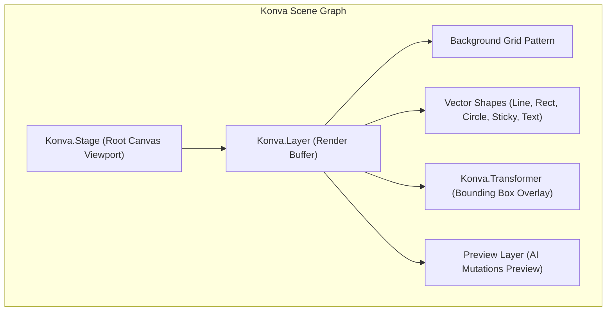
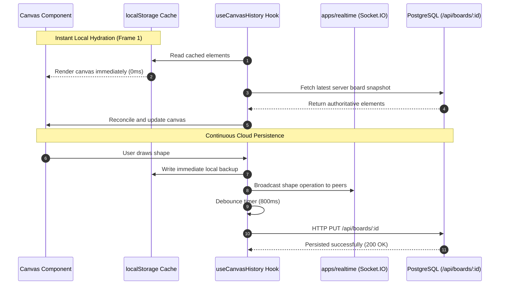

# Whiteboard Architecture Specification — COLLABO

> **Document Status:** Approved (Milestone M1 Specification)  
> **Package:** `@collabo/whiteboard` (`packages/whiteboard`)  
> **Rendering Technology:** React Konva (`konva 10.9`, `react-konva 19.3`)  
> **Target Audience:** Frontend Engineers, Graphics Developers, UX Engineers

---

## 1. Declarative 2D Canvas Engine

COLLABO uses **React Konva** to achieve high-performance declarative canvas rendering:
* **The Declarative Advantage:** Rather than writing imperative HTML5 Canvas context code (`ctx.beginPath()`), canvas nodes are declared as React components (`<Rect />`, `<Line />`, `<Text />`).
* **Performance Optimization:** Konva uses an offscreen buffer and batch draw calls (`layer.batchDraw()`), enabling 60 FPS drawing even when hundreds of vector elements populate the stage.
* **Client-Only Isolation:** Because canvas engines require browser globals (`HTMLCanvasElement`, `window`), the canvas stage is mounted using `next/dynamic` with `{ ssr: false }`.



---

## 2. 2D Coordinate Transformation & Camera Model

To support an **infinite spatial canvas**, the engine translates screen coordinates into world coordinates:

### Coordinate Math:
$$\begin{aligned}
x_{\text{world}} &= \frac{x_{\text{screen}} - x_{\text{stage}}}{\text{scale}} \\
y_{\text{world}} &= \frac{y_{\text{screen}} - y_{\text{stage}}}{\text{scale}}
\end{aligned}$$

* **Zooming:** Scales around the mouse pointer position so the focal point does not jump.
* **Panning:** Updates `stage.x()` and `stage.y()` when dragging while holding `Spacebar` or middle-click.

---

## 3. Element Data Models & Extensibility

Every canvas element extends a common base contract:

```ts
export interface BaseElement {
  id: string;
  type: ElementType;
  color: string;
  strokeWidth: number;
  rotation?: number;
  authorId?: string; // Tracks which user created the shape
}
```

### Supported & Planned Element Shapes:
1. `PenElement`: Freehand stroke points `points: number[]`, with tension smoothing.
2. `RectElement`: Geometric containers with `x`, `y`, `width`, `height`, `fill`.
3. `CircleElement`: Nodes and markers with `x`, `y`, `radius`.
4. `StickyElement`: Brainstorming cards with `fill`, `text`, auto-wrap text formatting.
5. `TextElement`: Standalone labels and headers with `fontSize`, `fontStyle`.
6. `ImageElement` *(Planned M8)*: Bitmaps and uploaded diagrams (`src`, `aspectRatio`).
7. `ConnectorElement` *(Planned M8)*: Smart arrows connecting two node IDs dynamically.

---

## 4. Selection, Transformation & Interaction

* **Konva Transformer:** When in `Select` mode (`V`), clicking an element attaches a `<Transformer>` bounding box with 8 resize anchors and a rotation handle.
* **Keyboard Hotkeys:**
  - `Delete` / `Backspace`: Removes selected element.
  - `Ctrl+Z` / `Cmd+Z`: Invokes Undo.
  - `Ctrl+Y` / `Cmd+Shift+Z`: Invokes Redo.
* **Inline Text Editing Replacement:**
  - *Current UX Debt:* Double-clicking a sticky note invokes browser `window.prompt()`.
  - *Architecture Redesign (M8):* Replaced with a floating HTML `<textarea>` positioned precisely over the Konva node in DOM space. On blur or `Enter`, text updates the canvas element.

---

## 5. Persistence & Multi-User Synchronization



### Evolution from Full Array Overwrites to Operational Diffs:
* **Current Baseline:** 800ms debounced HTTP PUT sending `{ elements: CanvasElement[] }`. This last-write-wins approach works for single users but causes collisions when multiple users edit concurrently.
* **Milestone M8 Target:** Operation-based synchronization (`op:create`, `op:update`, `op:delete`) over Socket.IO, with CRDT (Yjs) support to ensure conflict-free convergence across all classroom participants.
