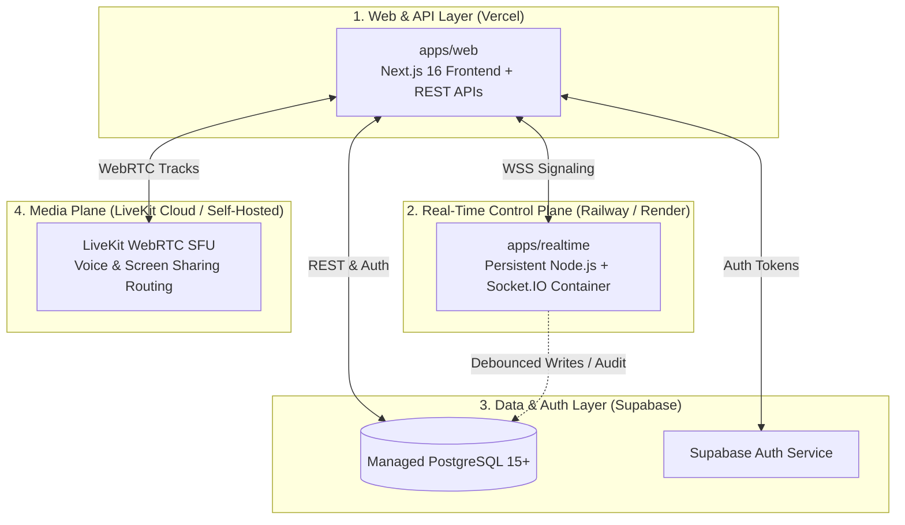

# Deployment & Infrastructure Guide — COLLABO

> **Document Status:** Approved (Milestone M1.5 Specification)  
> **Target Audience:** DevOps Engineers, System Administrators, Full-Stack Developers

---

## 1. Multi-Target Deployment Architecture

Because COLLABO separates stateless web requests from persistent real-time WebSockets and WebRTC media streams, the platform deploys across specialized infrastructure targets:

---

## 2. Infrastructure Targets Breakdown

### Target 1: `apps/web` on Vercel
* **Why Vercel:** First-class Next.js optimization, edge caching for static assets, automatic HTTPS, and global CDN delivery.
* **Root Directory Setting:** Set Root Directory in Vercel to `apps/web`.
* **Build Command:** `pnpm build`
* **Output Directory:** `.next`
* **Environment Variables:**
  - `NEXT_PUBLIC_APP_URL`
  - `NEXT_PUBLIC_SUPABASE_URL`
  - `NEXT_PUBLIC_SUPABASE_ANON_KEY`
  - `NEXT_PUBLIC_SOCKET_SERVER_URL` (URL of `apps/realtime`)
  - `LIVEKIT_API_KEY`
  - `LIVEKIT_API_SECRET`
  - `NEXT_PUBLIC_LIVEKIT_URL`

### Target 2: `apps/realtime` on Railway or Render
* **Why Container Runtime:** WebSockets require persistent TCP connections and shared in-memory room state. Serverless platforms terminate connections after short timeouts.
* **Runtime:** Node.js 20+ persistent container.
* **Build Command:** `pnpm --filter @collabo/realtime build`
* **Start Command:** `pnpm --filter @collabo/realtime start`
* **Health Check Endpoint:** `GET /health` (returns `{ status: "healthy", service: "collabo-realtime" }`).
* **Environment Variables:**
  - `PORT=4000`
  - `CORS_ORIGIN=https://collabo.edu`

### Target 3: Supabase PostgreSQL Database
* **Database Engine:** PostgreSQL 15+.
* **Connection Pooling:** Enabled via Supavisor / PgBouncer on port 6543 (transaction mode).
* **Migrations:** Managed via `supabase/migrations/` and executed chronologically.

### Target 4: LiveKit SFU (Media Plane)
* **Candidate Option A (Fastest setup):** LiveKit Cloud (managed multi-region SFU with global edge nodes).
* **Candidate Option B (Institutional self-hosting):** Single Docker container on an AWS EC2 or Hetzner VPS running `livekit-server`.

---

## 3. Production Health Monitoring & Telemetry

* **Socket Server Health:** Monitored via ping to `https://realtime.collabo.edu/health`.
* **Database Pool Utilization:** Monitored via Supabase metrics dashboard (active connections, cache hit ratio).
* **Client Errors:** Sentry error tracking integrated into `apps/web` for frontend crashes and unhandled promise rejections.

