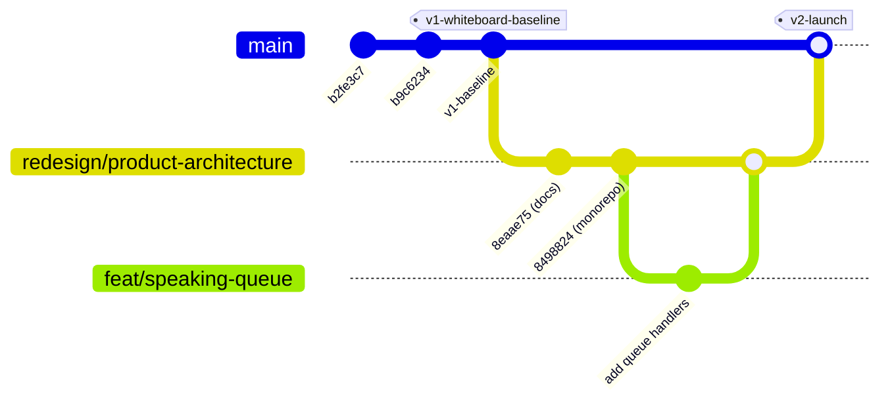

# Git Workflow & Preservation Strategy — COLLABO

> **Document Status:** Approved (Milestone M1.5 Specification)  
> **Target Audience:** All Engineers and Contributors Managing Branches & Commits

---

## 1. Branching Strategy & Lifecycle



### Core Branches:
* **`main`:** The stable baseline branch. Currently represents the single-user whiteboard baseline (`v1-whiteboard-baseline`).
* **`redesign/product-architecture`:** The active integration trunk for the institutional platform redesign (Milestones M0 through M10).
* **Feature Branches (`feat/*`, `fix/*`, `docs/*`):** Short-lived branches created for specific tasks and merged via Pull Requests.

---

## 2. Commit Discipline: The Atomic Commit Rule

Every commit must adhere to two mandatory standards:
1. **Conventional Commits Format:**
   ```text
   feat(realtime): add speaking queue grant handler
   fix(web): resolve canvas stage resizing offset on scroll
   docs(architecture): document database entity relationships
   ```
2. **Build Integrity:** Every commit must compile cleanly (`pnpm typecheck`) and pass linting (`pnpm lint`). Never commit half-finished code that breaks compilation for other developers.

---

## 3. Rollback & Preservation Procedures

Because we preserved the baseline with a Git tag, you can inspect or revert to the historical version at any time:

### A. Inspect the Baseline Code (Non-Destructive)
```bash
# Check out the baseline tag in detached HEAD mode (read-only)
git checkout v1-whiteboard-baseline

# Return to your active redesign branch
git checkout redesign/product-architecture
```

### B. Comparing Differences Between Redesign and Main
```bash
# View list of commit titles between main and redesign
git log --oneline main..redesign/product-architecture

# Inspect specific file diffs
git diff main..redesign/product-architecture -- apps/web/src/
```

### C. Golden Rules for Git Safety
* ❌ **Never Force-Push (`git push --force`)** to `main` or `redesign/product-architecture`.
* ❌ **Never Rewrite Published Commit History.**
* ❌ **Never Delete the Baseline Tag (`v1-whiteboard-baseline`).**

