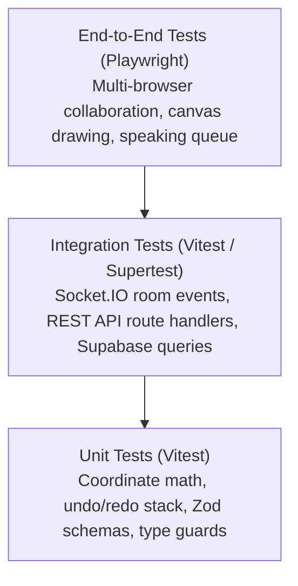

# Testing Strategy & Quality Assurance — COLLABO

> **Document Status:** Approved (Milestone M1.5 Specification)  
> **Target Audience:** All Engineers, QA Specialists, and AI Coding Agents

---

## 1. Testing Philosophy & Test Pyramid

COLLABO is a real-time distributed platform handling high-frequency user interactions, audio routing, and persistent whiteboard documents. Reliable automated testing is essential to prevent regressions.



---

## 2. Testing Layers & Tooling

### A. Unit Testing (`vitest`)
* **Focus:** Pure functions, state transformation algorithms, and data contracts.
* **Key Test Targets:**
  - 2D camera coordinate math: Screen-to-world and world-to-screen conversions.
  - History command stack in `useCanvasHistory` (verify undo/redo caps at 30 steps).
  - AI schema validation in `packages/shared` (Zod parsing).
  - Bounding box collision and shape hit-detection math.

### B. Integration Testing
* **Focus:** Component interaction with server APIs and WebSockets.
* **Key Test Targets:**
  - `apps/realtime`: Client connecting, joining a room, emitting `classroom:raise_hand`, and verifying queue broadcasts.
  - `apps/web/src/app/api/boards`: GET, POST, and PUT handlers with in-memory fallback and Supabase database.
  - Stale-While-Revalidate (SWR) cache reconciliation.

### C. End-to-End Testing (`playwright`)
* **Focus:** Browser-level user flows across multiple concurrent users.
* **Key Test Targets:**
  - **Multiplayer Collaboration Test:**
    1. Context A (Teacher) creates `#math-lecture` and draws a rectangle.
    2. Context B (Student) joins `#math-lecture`.
    3. Assert the rectangle renders on Student canvas in < 100ms.
  - **Speaking Queue Test:**
    1. Student clicks "Raise Hand".
    2. Teacher sees hand-raise notification and clicks "Grant Mic".
    3. Student UI updates to "Microphone unmuted".

---

## 3. Playwright Multi-User Test Example

```ts
import { test, expect } from "@playwright/test";

test("Multi-user whiteboard synchronization", async ({ browser }) => {
  // 1. Create two isolated browser contexts (Teacher & Student)
  const teacherContext = await browser.newContext();
  const studentContext = await browser.newContext();

  const teacherPage = await teacherContext.newPage();
  const studentPage = await studentContext.newPage();

  // 2. Both navigate to the same board
  const roomId = `test-room-${Date.now()}`;
  await teacherPage.goto(`http://localhost:3000/board/${roomId}`);
  await studentPage.goto(`http://localhost:3000/board/${roomId}`);

  // 3. Teacher draws a shape
  await teacherPage.keyboard.press("R"); // Select Rectangle
  await teacherPage.mouse.click(300, 300);

  // 4. Verify shape count on Teacher HUD
  await expect(teacherPage.locator("text=1 shape")).toBeVisible();

  // 5. Verify Student receives the shape via real-time sync
  await expect(studentPage.locator("text=1 shape")).toBeVisible();
});
```

---

## 4. CI/CD Integration Roadmap (Milestone M10)

Before merging any pull request to `main` or `redesign/product-architecture`, the GitHub Actions automated pipeline will execute:
1. `pnpm typecheck` (zero TypeScript errors).
2. `pnpm lint` (zero ESLint warnings/errors).
3. `pnpm test:unit` (Vitest unit test suite).
4. `pnpm test:e2e` (Playwright headless Chromium smoke tests).

