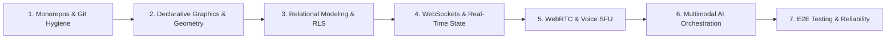

# Engineering Learning Path & Curriculum — COLLABO

> **Audience:** Solo Undergraduate Developer & Future Junior Engineers  
> **Goal:** Transition from a student coder writing prototype scripts into a senior-caliber full-stack distributed systems engineer capable of designing, building, and explaining enterprise platforms.

---

## Curriculum Overview

---

## Module 1: Monorepos, Package Workspaces & Professional Git
* **Core Concepts:**
  - Why monorepos exist (atomic commits, shared type contracts, decoupled apps).
  - pnpm workspace protocols (`workspace:*`) and content-addressable storage.
  - Conventional Commits and Git preservation tagging (`v1-whiteboard-baseline`).
* **Hands-on in COLLABO:**
  - Create and configure `pnpm-workspace.yaml`.
  - Share types between `apps/web` and `apps/realtime` via `packages/shared`.
* **What you can now explain in an interview:**
  - *"How pnpm symlinks workspace dependencies without publishing to npm, and why atomic commits protect continuous integration pipelines."*

---

## Module 2: Declarative 2D Canvas Graphics & Coordinate Geometry
* **Core Concepts:**
  - Immediate mode (imperative canvas context) vs. Declarative mode (React Konva scene graph).
  - 2D coordinate spaces: Screen pixels vs. World canvas coordinates.
  - Transformation math: Matrix scaling, translation, and bounding box hit-detection.
  - The Command Pattern: Building undo/redo stacks.
* **Hands-on in COLLABO:**
  - Implement infinite canvas camera (pan and zoom math).
  - Fix coordinate translation when dragging freehand pen lines.
  - Implement interactive bounding-box transformers.
* **What you can now explain in an interview:**
  - *"How coordinate normalization works when translating mouse events across varied zoom levels and screen viewports."*

---

## Module 3: Relational Data Modeling & PostgreSQL Row-Level Security
* **Core Concepts:**
  - Relational schema design: Normalization vs. JSONB document storage.
  - Database triggers (`BEFORE UPDATE` timestamp updates).
  - Connection pooling (Supavisor / PgBouncer) for burst traffic.
  - Row-Level Security (RLS) enforcement at the database layer.
* **Hands-on in COLLABO:**
  - Author additive SQL migrations for institutions, courses, and sessions.
  - Write RLS policies ensuring students can only view their own attendance records.
* **What you can now explain in an interview:**
  - *"Why storing serialized whiteboard documents in JSONB provides atomic document saves, while normalized tables handle indexing and fine-grained queries."*

---

## Module 4: Stateful Distributed Systems & WebSocket Signaling
* **Core Concepts:**
  - Stateless HTTP request-response vs. Full-duplex persistent TCP WebSockets.
  - In-memory room coordination and ephemeral event broadcasting.
  - Reconnection heuristics and exponential backoff.
  - Horizontal scaling with Redis Pub/Sub adapters.
* **Hands-on in COLLABO:**
  - Build `apps/realtime` with Node.js, TypeScript, and Socket.IO.
  - Implement the speaking queue with hand-raise state and host mic grants.
  - Broadcast ephemeral cursor movements with volatile packet throttling.
* **What you can now explain in an interview:**
  - *"Why serverless functions cannot maintain continuous WebSocket connections or in-memory room states, and how Redis clusters enable horizontal WebSocket scaling."*

---

## Module 5: WebRTC Protocols & Voice SFU Architecture
* **Core Concepts:**
  - Real-Time Protocol (RTP/RTCP), DTLS-SRTP encryption, and ICE/STUN/TURN negotiation.
  - Peer-to-Peer (P2P) mesh network limits ($O(N^2)$) vs. Selective Forwarding Units (SFUs).
  - Dynamic audio gating: Why voice-only virtual classrooms require a dedicated media plane rather than WebSocket audio streaming.
* **Hands-on in COLLABO:**
  - Integrate LiveKit client SDK into `apps/web`.
  - Issue cryptographically signed token grants from `apps/realtime`.
  - Implement screen-share track publishing and student subscription.
* **What you can now explain in an interview:**
  - *"How an SFU routes media packets to 250+ clients without transcoding, and why WebRTC UDP streaming eliminates buffer jitter compared to WebSockets."*

---

## Module 6: Generative AI Orchestration & Multimodal Embeddings
* **Core Concepts:**
  - Provider-agnostic LLM client design.
  - Spatial context serialization (converting 2D visual canvas graphs into LLM prompts).
  - Structured output enforcement using Zod schemas.
  - Human-in-the-loop safety: The Preview Mutation Layer pattern.
* **Hands-on in COLLABO:**
  - Connect Google Gemini API to parse lecture text into structured mind-map nodes.
  - Render translucent canvas preview overlays before committing shapes to board state.
* **What you can now explain in an interview:**
  - *"How to design non-destructive generative AI workflows that validate LLM outputs against strict schemas before modifying user canvas state."*

---

## Module 7: End-to-End Automation & Production Hardening
* **Core Concepts:**
  - The Testing Pyramid: Unit tests, integration tests, and multi-browser E2E testing.
  - Headless browser automation with Playwright.
  - Load testing high-concurrency WebSocket rooms.
* **Hands-on in COLLABO:**
  - Write Playwright tests verifying real-time whiteboard sync across two concurrent browser sessions.
  - Automate typecheck and lint verification in GitHub Actions CI.

