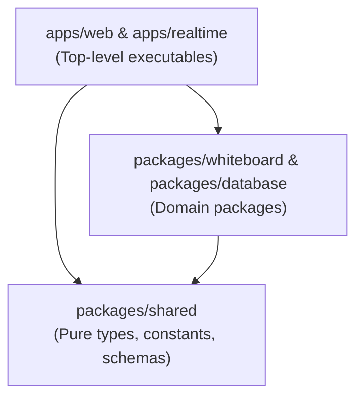

# Monorepo Project Structure — COLLABO

> **Document Status:** Approved (Milestone M1.5 Specification)  
> **Repository Strategy:** Modular Monorepo with `pnpm` Workspaces  
> **Target Audience:** All Engineers and Contributors

---

## 1. Directory Tree Map

```
collabo/
│
├── apps/                                             # Deployable Applications
│   ├── web/                                          # Next.js 16 Web Application & Dashboard
│   │   ├── public/                                   # Static assets, branding logos
│   │   ├── src/
│   │   │   ├── app/                                  # Next.js App Router (pages & API routes)
│   │   │   │   ├── api/boards/                       # REST endpoints for board document persistence
│   │   │   │   ├── board/[id]/                       # Dynamic collaborative whiteboard route
│   │   │   │   ├── layout.tsx                        # Global HTML root layout
│   │   │   │   └── page.tsx                          # Marketing landing page & quick launcher
│   │   │   ├── components/                           # React UI primitives & board components
│   │   │   ├── hooks/                                # Custom hooks (useCanvasHistory, etc.)
│   │   │   ├── lib/                                  # Supabase client & in-memory offline fallback
│   │   │   └── types/                                # Application-specific types
│   │   ├── next.config.ts                            # Next.js compiler & Turbopack configuration
│   │   ├── tsconfig.json                             # TypeScript path mappings (@/*, @collabo/shared)
│   │   └── package.json                              # @collabo/web package contract
│   │
│   └── realtime/                                     # Dedicated Real-time Control Plane Server
│       ├── src/
│       │   └── index.ts                              # Standalone Node.js + Socket.IO server entrypoint
│       ├── dist/                                     # Compiled JavaScript output
│       ├── tsconfig.json                             # Server TypeScript configuration
│       └── package.json                              # @collabo/realtime package contract
│
├── packages/                                         # Reusable Internal Libraries
│   ├── shared/                                       # Shared TypeScript Types & Contracts
│   │   ├── src/
│   │   │   ├── canvas.ts                             # CanvasElement, CanvasTool, ColorOption
│   │   │   ├── database.ts                           # BoardRecord, API responses, payload contracts
│   │   │   └── index.ts                              # Barrel export
│   │   ├── tsconfig.json                             # Library TypeScript configuration
│   │   └── package.json                              # @collabo/shared package contract
│   │
│   ├── whiteboard/                                   # (Scheduled for physical extraction)
│   └── database/                                     # (Scheduled for physical extraction)
│
├── supabase/                                         # Database Migrations & Seed Data
│   └── migrations/
│       └── 20261030000001_create_boards_table.sql    # Baseline DDL migration (boards, profiles, elements)
│
├── docs/                                             # Engineering & Product Documentation
│   ├── product/                                      # PRD, user journeys, requirements, feature catalog
│   ├── architecture/                                 # Systems overview, database schema, realtime, security
│   ├── decisions/                                    # ADR-001 through ADR-004
│   ├── engineering/                                  # Development setup, coding standards, testing, git
│   ├── onboarding/                                   # Start here, structure, contributor & AI guides
│   ├── learning/                                     # Concept glossary, learning path, engineering notes
│   └── operations/                                   # Environment variables, troubleshooting runbooks
│
├── .env.example                                      # Environment variable template
├── .gitignore                                        # Global monorepo ignore rules
├── AGENTS.md                                         # AI Agent Constitution & Engineering Directive
├── README.md                                         # Project Overview (Owner-maintained, DO NOT EDIT)
├── pnpm-workspace.yaml                               # Monorepo workspace configuration
├── pnpm-lock.yaml                                    # Pnpm frozen lockfile
└── package.json                                      # Monorepo root coordination scripts
```

---

## 2. Package Dependency Boundaries

To maintain clean architecture and prevent circular dependencies, cross-package imports must adhere to this hierarchy:



* **Rule 1 (Downstream Only):** `packages/shared` has zero internal dependencies. It must **never** import from `apps/` or other packages.
* **Rule 2 (No Cross-App Coupling):** `apps/web` must **never** import directly from `apps/realtime` (or vice versa). Communication between apps occurs purely over network protocols (WebSocket or HTTP).
* **Rule 3 (Local Workspace Linking):** All internal packages are referenced via `"workspace:*"` in `package.json`.

