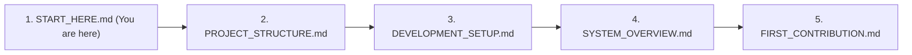

# Welcome to COLLABO — Start Here

> **Welcome to the team!** Whether you are a student contributor, an open-source engineer, or an AI coding assistant joining the project, this guide will orient you in under 5 minutes.

---

## 1. What is COLLABO?

**COLLABO** is an institution-oriented collaborative learning platform built on three architectural pillars:
1. **COLLABO Rooms:** Voice-first virtual classrooms supporting 250+ concurrent participants with high-definition screen sharing, speaking queues, and teacher moderation (no distracting webcam video tiles).
2. **COLLABO Workspace:** A high-performance 2D collaborative whiteboard powered by React Konva, with instant local hydration, vector shapes, sticky notes, and cloud persistence.
3. **COLLABO Intelligence:** Context-aware pedagogical AI (powered by Google Gemini API) for generating visual mind maps, summarizing lectures, answering board queries, and creating revision quizzes.

---

## 2. Five-Minute Quickstart

Get the entire monorepo running locally on your computer:

### Step 1: Prerequisites
Ensure you have:
* **Node.js:** `v20.x` or later (tested on Node `v24.x`)
* **pnpm:** `v10.x` or later (tested on `v12.x`)
* **Git:** Installed and configured

### Step 2: Clone and Install
```bash
git clone https://github.com/Mayank32935M/Collabo.git
cd Collabo
pnpm install
```

### Step 3: Launch Local Services
```bash
# Launch the Next.js Web App (port 3000)
pnpm dev

# In a second terminal, launch the Socket.IO Real-time Control Server (port 4000)
pnpm dev:realtime
```

Visit [http://localhost:3000](http://localhost:3000) to view the application!

---

## 3. Reading Roadmap for New Contributors

Before making your first code change, read these core documents in order:



1. [`docs/onboarding/PROJECT_STRUCTURE.md`](file:///d:/Projects/Collabo/docs/onboarding/PROJECT_STRUCTURE.md) — Understand where code lives across `apps/` and `packages/`.
2. [`docs/engineering/DEVELOPMENT_SETUP.md`](file:///d:/Projects/Collabo/docs/engineering/DEVELOPMENT_SETUP.md) — Detailed environment setup, scripts, and debugging tips.
3. [`docs/architecture/SYSTEM_OVERVIEW.md`](file:///d:/Projects/Collabo/docs/architecture/SYSTEM_OVERVIEW.md) — The 3-plane architecture (Control Plane, Media Plane, Data Plane).
4. [`docs/learning/CONCEPT_GLOSSARY.md`](file:///d:/Projects/Collabo/docs/learning/CONCEPT_GLOSSARY.md) — Plain-English explanations of WebRTC, SFU, SWR, and declarative canvas graphics.
5. [`docs/onboarding/FIRST_CONTRIBUTION.md`](file:///d:/Projects/Collabo/docs/onboarding/FIRST_CONTRIBUTION.md) — Step-by-step walkthrough of submitting your first pull request.

---

## 4. Key Rules to Remember

* **Human-Led, AI-Assisted:** If you are using an AI coding assistant (like Antigravity or Claude Code), ensure it follows the constitution in [`AGENTS.md`](file:///d:/Projects/Collabo/AGENTS.md).
* **Never Modify `README.md` Directly:** The root `README.md` is manually maintained by the repository owner.
* **Never Modify Applied SQL Migrations Destructively:** All database schema changes must be new, additive migrations in `supabase/migrations/`.
* **Verify Before Committing:** Run `pnpm typecheck` and `pnpm lint` before pushing any branch.

