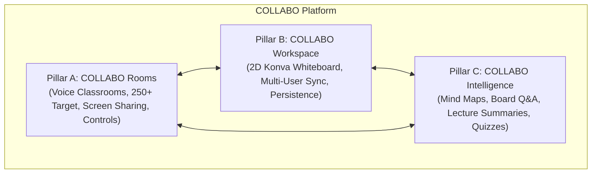

# Product Requirements Document (PRD) — COLLABO

> **Document Version:** 2.0.0  
> **Status:** Approved (Milestone M1 Specification)  
> **Product Name:** COLLABO  
> **Tagline:** Think together. Build ideas together. Learn together.  
> **Primary Audience:** Educational Institutions, University Faculties, Student Study Groups, and Hackathon Teams

---

## 1. Executive Summary & Product Vision

COLLABO is evolving from a lightweight student whiteboard into an **institution-oriented collaborative learning platform**.

Modern higher-education and collaborative learning environments suffer from extreme tool fragmentation:
1. **Video Fatigue & Bandwidth Strain:** Video calling platforms (Zoom, Teams) mandate heavy camera streams that consume bandwidth, cause participant anxiety, and degrade in large classes (100–250+ students).
2. **Passive One-Way Lectures:** Standard webinar software reduces students to passive listeners with clunky chat boxes and zero visual co-working.
3. **Disjointed Workspaces:** Whiteboards (Miro, FigJam) are separate from audio calls, expensive for institutions, and lack classroom structure (courses, attendance, speaking queues).
4. **Disconnected AI:** AI tools operate in isolated text prompts, unaware of the visual board or the lecture context.

**COLLABO solves this** by unifying **voice-first virtual classrooms**, a **high-performance collaborative whiteboard**, and **context-aware AI intelligence** into a single cohesive platform.



---

## 2. Target Personas & Use Cases

### Persona 1: Dr. Aris Thorne — The University Professor
* **Role:** Computer Science Professor teaching 200+ students in "Distributed Systems".
* **Pain Points:** Video calling eats bandwidth and causes lag. Clunky breakout rooms. Students rarely ask questions because interrupting an audio stream feels disruptive.
* **Needs in COLLABO:**
  - Launch a scheduled lecture in **Lecture Mode** with crystal-clear voice and screen sharing.
  - Keep students muted by default while monitoring a live **Speaking Queue** (students raise hands).
  - Switch smoothly between presentation slides and an interactive whiteboard for system architecture diagrams.
  - Automatically log classroom attendance and trigger an AI lecture summary for absent students.

### Persona 2: Priya Patel — The Undergraduate Student
* **Role:** 2nd-year Engineering Student attending remote lectures and leading study groups.
* **Pain Points:** Afraid to interrupt professors; taking frantic manual notes while trying to follow diagrams; losing track of shared materials.
* **Needs in COLLABO:**
  - One-click join to course classrooms from the student dashboard without complex invite codes.
  - Raise hand to enter the speaking queue; unmute only when granted speaking rights.
  - Access persistent session whiteboards after class to review diagrams.
  - Generate flashcards and quizzes from the session using COLLABO Intelligence.

### Persona 3: Marcus Vance — The Institution Administrator
* **Role:** IT Director / Academic Dean at a technical college.
* **Pain Points:** Tool sprawl, uncontrolled software licensing costs, lack of audit trails, compliance and data privacy concerns.
* **Needs in COLLABO:**
  - Provision and manage university departments, faculty accounts, and course rosters.
  - Assign instructors to courses without having to grant full IT admin rights.
  - Ensure data isolation between departments and preserve student privacy.

### Persona 4: Alex & Sam — The Hackathon / Open Project Team
* **Role:** Independent developers building a hackathon prototype over a weekend.
* **Pain Points:** Enterprise educational tools require university logins, slow approvals, and institutional billing.
* **Needs in COLLABO:**
  - Jump directly into an open, persistent whiteboard (`/board/hackathon-squad`) without an institutional email.
  - Brainstorm system flows, sticky notes, and UI mockups in real time.

---

## 3. Product Pillar A: COLLABO Rooms (Live Collaboration & Classrooms)

COLLABO Rooms is the live audio and classroom coordination engine.

### A. Core Architecture & Capacity Target
* **Target Capacity:** 250+ concurrent participants per room. Scaled and verified incrementally through automated load testing.
* **Audio-First Media Model:** **Voice-only communication**. There is **no participant webcam video calling**. This drastically reduces bandwidth consumption, CPU load, and server costs.
* **Screen Sharing:** Supported via high-definition WebRTC video tracks published by the presenter (host or granted participant).

### B. Classroom Operational Modes
1. **Lecture Mode (Default for large classes):**
   - Teacher/Host broadcasts high-fidelity voice.
   - All student microphones are muted by default.
   - Screen sharing and whiteboard editing are controlled by the host.
   - Students participate via text chat, live polls, Q&A, and the **Speaking Queue**.
2. **Interactive Mode (Discussion & seminar format):**
   - Multiple participants can hold active speaking privileges concurrently.
   - Suited for smaller classes (under 50), team breakouts, and project reviews.
   - Host retains instant master mute and moderation controls.

### C. Host & Moderation Controls
* **Speaking Queue:** Students click "Raise Hand". The host sees a chronological queue with student names, profile badges, and time elapsed. The host can grant mic access, dismiss, or lower hands.
* **Host & Co-Host Privileges:** Primary instructors can designate teaching assistants (TAs) as co-hosts to moderate chat, admit students from waiting rooms, and manage polls.
* **Waiting Room & Access Gate:** Enforces institutional course membership or passcode protection. Guests can be placed in a waiting room until admitted.
* **Mute All / Individual Mute:** Instant emergency mute controls that cut mic audio at the media plane.
* **Automated Attendance:** Logs join time, leave time, duration, and participation score (polls answered, questions asked).

---

## 4. Product Pillar B: COLLABO Workspace (Collaborative Whiteboard)

COLLABO Workspace is the spatial visual thinking canvas, deeply integrated into live rooms and available as standalone persistent boards.

### A. Canvas Capabilities
* **Core Shapes & Vectors:** Freehand pen with smooth tension, rectangles, circles, diamonds, arrows, lines, text labels, and color-coded sticky notes.
* **Object Transformation:** Move, multi-anchor resize, bounding box rotation, and snapping alignment guides.
* **Infinite Spatial Model:** Pan (drag canvas or spacebar+drag) and Zoom (scroll wheel / pinch-to-zoom) with an underlying adaptive grid.
* **Asset Support:** Image upload/paste (PNG, JPEG, SVG) and PDF resource rendering directly onto the canvas.
* **Undo / Redo:** Local history command stack preserving individual author edits.

### B. Classroom & Board Lifecycle
* **Session-Linked Boards:** When a classroom session starts, the instructor can load an existing course board or spawn a fresh session board.
* **Board Permissions:**
  - *Instructor-Only Drawing:* Students view live canvas updates in real time without edit rights.
  - *Collaborative Whiteboard:* Instructor grants drawing access to the entire class or specific student groups.
* **Durability & Caching:** Instant Stale-While-Revalidate (SWR) client hydration from `localStorage` combined with reliable cloud persistence to PostgreSQL.

---

## 5. Product Pillar C: COLLABO Intelligence (AI-Assisted Learning)

COLLABO Intelligence provides pedagogical AI capabilities embedded directly into classrooms and whiteboards.

### A. Core Intelligence Features
1. **Mind-Map & Flowchart Generation:** Converts raw lecture transcripts, textbook excerpts, or syllabus outlines into structured, visual nodes on the canvas.
2. **Board-Aware Q&A:** Students or instructors can ask questions referencing the board: *"Explain the database relationship shown in the blue box."* The AI inspects board elements, spatial coordinates, and text labels to formulate accurate visual answers.
3. **Lecture Recaps & Summaries:** Automatically synthesizes the session's audio transcript, chat questions, and whiteboard diagrams into a structured Markdown revision guide.
4. **Automated Quiz & Flashcard Generator:** Generates multiple-choice questions and spaced-repetition flashcards grounded in the concepts drawn on the board.
5. **Auto-Organize Canvas:** Detects scattered sticky notes and clusters them by semantic topic (e.g. "Frontend", "Database", "Security").

### B. AI Safety & Non-Destructive Mutation Rules
* **Preview Before Apply:** AI-generated canvas additions are rendered as a translucent preview layer. The user or instructor must click **Accept** or **Reject** before shapes commit to the board.
* **Provider-Agnostic Architecture:** Built with an abstraction layer supporting Google Gemini API, OpenAI, Anthropic, or local open weights without hardcoded dependencies.
* **Privacy & Isolation:** Institutional data and student conversations are never used to train public foundation models.

---

## 6. Institutional User & Identity Model

COLLABO supports a **hybrid identity model**:

```
[COLLABO Platform]
   ├── Open / Independent Tier (Hackathons, Study Groups, Freelancers)
   │     └── Personal User Accounts & Standalone Boards
   │
   └── Institutional Tier (Universities, Colleges, Schools)
         └── Institution Workspace
               └── Departments (e.g. "Computer Science", "Physics")
                     └── Courses (e.g. "CS301: Operating Systems")
                           ├── Course Enrollments (Teachers, Students, TAs)
                           └── Classrooms & Scheduled Sessions
```

### Institutional Roles vs. Classroom Roles
* **Institutional Roles (Static, long-term permissions):**
  - **Institution Admin:** Manages billing, department creation, instructor invitations, and platform settings.
  - **Department Head:** Manages departmental courses and faculty allocations.
  - **Instructor / Faculty:** Creates and manages courses, enrolls students, schedules sessions.
  - **Student:** Enrolls in courses, attends sessions, accesses learning resources.
* **Classroom Session Roles (Dynamic, in-room privileges):**
  - **Host (Instructor):** Full control over audio, screen sharing, whiteboard edit modes, and speaking queues.
  - **Co-Host (TA):** Can admit students, manage chat, trigger polls, and moderate the queue.
  - **Speaker (Granted Student):** Temporarily permitted to publish microphone audio.
  - **Attendee (Student):** Listens to audio, views screen/board, participates in chat and polls.

---

## 7. Non-Functional Requirements & Performance Targets

| Metric | Target | Verification Method |
|---|---|---|
| **Classroom Audio Capacity** | 250+ concurrent listeners per room | Headless client simulation via WebRTC benchmark scripts |
| **Audio Latency** | < 150 ms end-to-end | LiveKit SFU telemetry and WebRTC stats |
| **Control Plane Latency** | < 50 ms for hand raises, mutes, chat | Socket.IO roundtrip heartbeat telemetry |
| **Canvas Render Speed** | 60 FPS up to 1,000 shapes | Chrome DevTools Performance Profiler & React Konva batch draw |
| **Cloud Auto-Save Delay** | 800 ms debounce | Network PUT request monitoring |
| **SWR Client Hydration** | < 50 ms instant local load | Client performance marks on `localStorage` parsing |

---

## 8. Explicit Non-Goals & Scope Boundaries

* ❌ **No Participant Webcam Video:** COLLABO will not implement multi-camera video tiles (Zoom-style). Video is strictly reserved for screen sharing.
* ❌ **No Raw WebSocket Audio:** Voice streaming will not be built on top of WebSocket TCP packets.
* ❌ **No Premature Microservices:** All backend services will live in the modular monorepo, keeping deployment simple for a solo developer.
* ❌ **No Silent Destructive Migrations:** Database migrations will strictly remain additive and backward-compatible.
