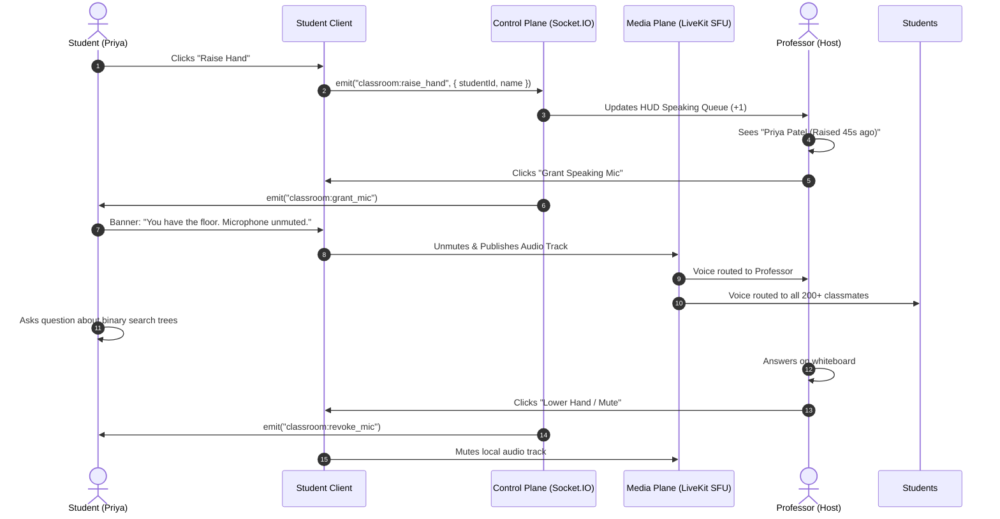
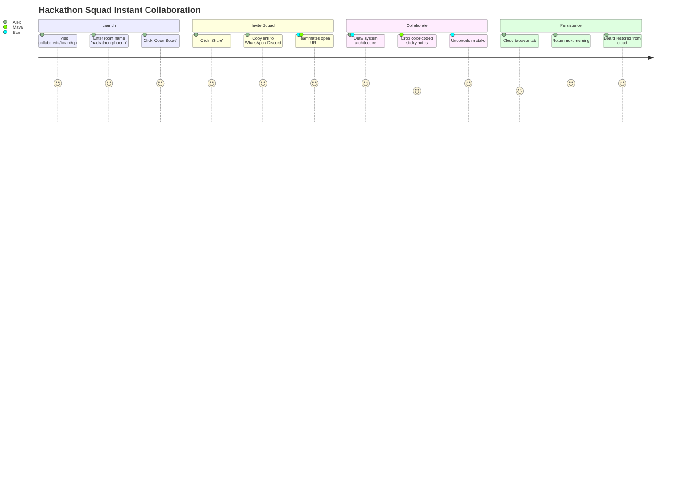
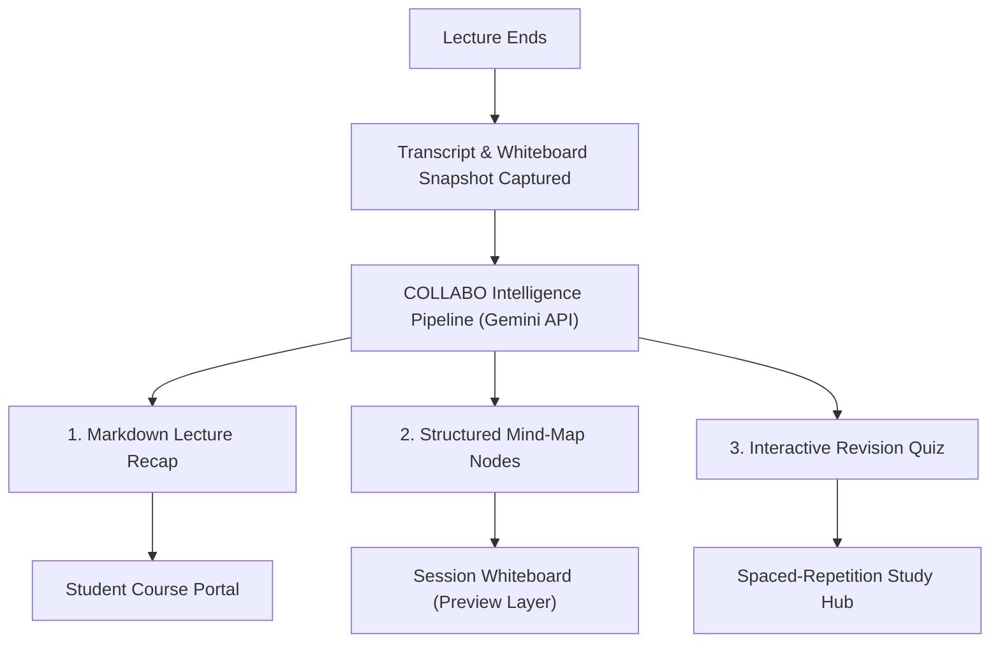

# User Journeys & Experience Flows — COLLABO

> **Document Status:** Approved (Milestone M1 Specification)  
> **Target Audience:** Product Managers, Designers, Engineers, and Future Contributors

---

## Journey 1: University Professor Hosting a 200+ Student Voice Lecture

```mermaid
sequenceDiagram
    autonumber
    actor Prof as Professor (Host)
    participant Web as COLLABO Web App
    participant RT as Control Plane (Socket.IO)
    participant SFU as Media Plane (LiveKit SFU)
    actor Students as 200+ Students (Attendees)

    Prof->>Web: Clicks "Start Scheduled Lecture"
    Web->>RT: Initialize Session (RoomId, Mode: "Lecture")
    Web->>SFU: Publish Teacher Microphone Track
    Web->>SFU: Publish Screen Share Video Track
    Students->>Web: Join Classroom via Course Dashboard
    Web->>RT: Socket Handshake (Role: "Attendee")
    RT->>Students: Muted by default; listen-only audio stream
    Students->>SFU: Subscribe to Teacher Audio & Screen Share
    Prof->>Web: Draws architecture diagram on session whiteboard
    Web->>RT: Broadcast board updates to classroom
    RT->>Students: Whiteboard syncs live in real-time
```

### Detailed Flow:
1. **Pre-Session Setup:**
   - Dr. Aris opens his Course Page (`/courses/cs301/lecture-14`).
   - He selects **"Start Lecture"**. The system defaults to **Lecture Mode**.
   - COLLABO prompts for microphone input and screen share display.
2. **Session Launch & Media Ingestion:**
   - The Next.js frontend connects to `apps/realtime` via WebSocket, joining room `cs301-lec-14` as `Host`.
   - The client connects to the LiveKit SFU, publishing high-definition Opus audio (mic) and VP8/H.264 video (screen share).
3. **Student Admission:**
   - 200+ enrolled students navigate to their dashboard and click **"Join Lecture"**.
   - Each student joins the Socket.IO room as an `Attendee`.
   - Their microphones remain disabled by default at the browser media level.
   - The student client subscribes to the SFU audio and screen tracks with sub-150ms latency.
4. **Interactive Teaching:**
   - Dr. Aris splits the interface: screen share on the left, COLLABO collaborative whiteboard on the right.
   - As he draws sticky notes and arrows, elements sync out to all students smoothly.

---

## Journey 2: Student Asking a Question in the Speaking Queue



### Key Experience Safeguards:
* The student's mic is **never automatically hot without user awareness**; a visible countdown and green audio meter appear.
* The host has a permanent **"Mute All Immediately"** hotkey (`Ctrl+Shift+M`) that cuts all active speaker tracks instantaneously.

---

## Journey 3: Hackathon Team Launching an Instant Open Board



### Detailed Flow:
1. Alex visits COLLABO's landing page, types `hackathon-phoenix` into the Quick Launcher, and clicks **Open Board**.
2. No login is mandatory for basic brainstorming; a guest session token is generated in `localStorage`.
3. Alex clicks **Share** and copies `https://collabo.edu/board/hackathon-phoenix` into his team's Discord.
4. Sam and Maya join the board. Distinct pastel colors are assigned to each user's cursor.
5. They sketch backend APIs, database schemas, and place sticky notes concurrently.
6. The board auto-saves continuously every 800ms to PostgreSQL via debounced REST API.
7. The squad shuts their laptops. Next morning, all drawings and notes load instantly via SWR caching.

---

## Journey 4: Institution Admin Managing Departments & Courses

1. **Sign-In & Verification:**
   - Dean Vance navigates to `/admin` and signs in with institutional SSO / email credentials.
2. **Department Management:**
   - Opens the **"Departments"** panel.
   - Creates the `Department of Computer Science`.
   - Designates Dr. Thorne as Department Lead.
3. **Course Provisioning:**
   - Adds Course `CS301: Advanced Operating Systems`.
   - Assigns Dr. Thorne as Primary Instructor and 2 graduate TAs as Co-Hosts.
4. **Roster Enrollment:**
   - Uploads a CSV roster containing 240 student university emails.
   - The platform sends email invites with magic links and pre-provisions course access.
5. **Classroom Settings Configuration:**
   - Configures default mode: `Lecture Mode`.
   - Enables `Automatic Attendance Logging` and `Session Whiteboard Archival`.

---

## Journey 5: Post-Lecture AI Synthesis & Study Assistance



### Detailed Flow:
1. The lecture concludes. Dr. Aris clicks **"End Session"**.
2. The platform commits the final board state to PostgreSQL and assembles the session telemetry.
3. The student opens the session archive on their laptop:
   - **Lecture Recap:** Reads a structured 3-paragraph summary with key takeaways and timestamps.
   - **Board Mind-Map:** The student clicks *"Generate Mind-Map from Lecture"*. The AI parses the lecture concepts and suggests new nodes. A translucent preview appears on the whiteboard; the student clicks **"Apply to Board"**.
   - **Flashcard Generation:** The student clicks *"Create Revision Quiz"*. The AI generates 10 practice questions directly testing the architecture diagrams created during class.

